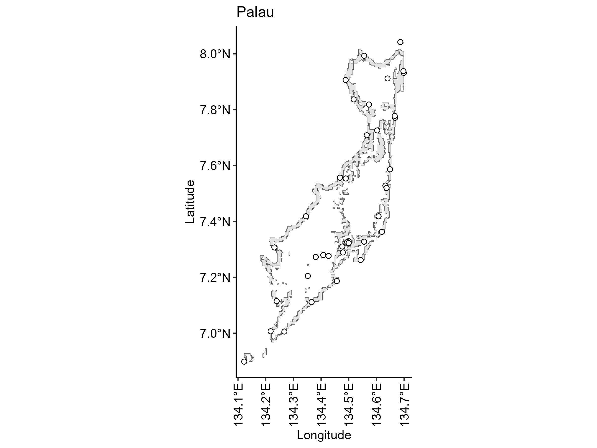
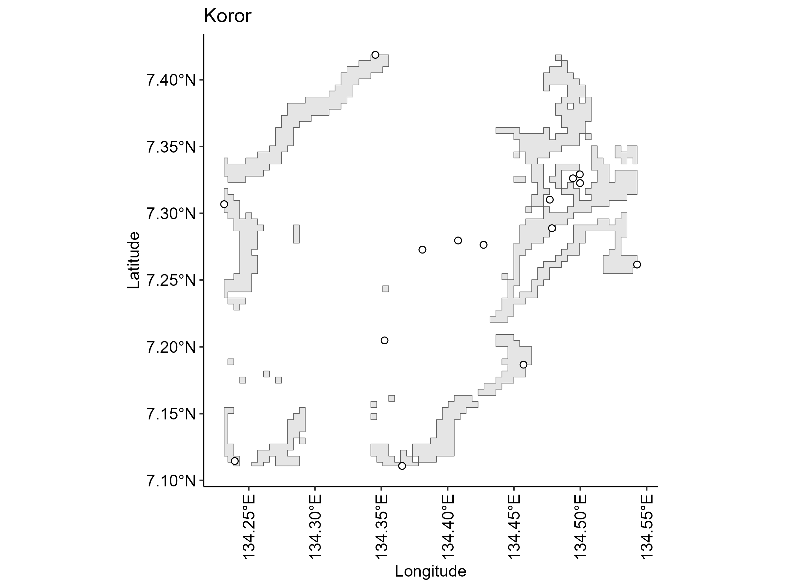

```{r, include = FALSE}
knitr::opts_chunk$set(
  collapse = TRUE,
  comment = "#>"
)
```

## Setting up

```{r setup, message = FALSE, warning = FALSE, eval=FALSE}
# Load packages
remotes::install_github("ReefCloud/reefcloudreporting")
library(reefcloudreporting)
library(sf)
library(ggplot2)
library(dplyr)
library(purrr)
library(stringi)
library(ggrepel)
library(ggpubr)
```

## 1. Generate tiers id 

```{r extract-tierid, message = FALSE, warning = FALSE, eval=FALSE}
# Named by the geographic name passed in, so it can label each map later
place_names <- c("Palau", "Koror")
tierids <- purrr::map(place_names, extract_tierid) %>%
  setNames(place_names)
```

## 2. Extract bounding box and site locations

```{r bbox, message = FALSE, warning = FALSE, eval=FALSE}
bboxes <- purrr::map(tierids, function(ids) {
  purrr::map(ids, get_bbox)
})
```

## 4. Create the map 

```{r map, message = FALSE, warning = FALSE, eval=FALSE}

# Unzip folder containing the shapefile
unzip("../ext/TropicalCoralReefsOfTheWorld.zip", exdir = "../extdata")

# Read reef shapefile
reef_shp <- st_read("../extdata/reef_500_poly.shp", quiet = TRUE) %>%
           st_transform(crs = 4326) %>%
           st_make_valid()

# One map per top-level bboxes entry, combining all nested ids it contains
maps <- purrr::imap(bboxes, function(entries, place_name) {

  sites_all <- dplyr::bind_rows(purrr::map(entries, "sites"))

  bbox_mat <- do.call(rbind, purrr::map(entries, "bbox"))
  bbox_combined <- sf::st_bbox(
    c(
      xmin = min(bbox_mat[, "xmin"]),
      ymin = min(bbox_mat[, "ymin"]),
      xmax = max(bbox_mat[, "xmax"]),
      ymax = max(bbox_mat[, "ymax"])
    ),
    crs = sf::st_crs(reef_shp)
  )

  reef_cut <- sf::st_crop(reef_shp, bbox_combined)

  ggplot() +
    geom_sf(data = reef_cut, fill = "gray90") +
    geom_sf(data = sites_all, shape = 21, color = "black", fill = "white", size = 2) +
    theme_pubr() +
    theme(axis.text.x = element_text(angle = 90, vjust = 0.5, hjust = 1)) +
    ggtitle(place_name) +
    xlab("Longitude") + ylab("Latitude")
})

# Save each map to the figure folder, creating it if needed
dir.create("figures", showWarnings = FALSE, recursive = TRUE)
purrr::iwalk(maps, function(map, place_name) {
  ggsave(
    filename = file.path("figures", paste0(place_name, ".png")),
    plot = map,
    width = 8, height = 6, dpi = 300
  )
})
```

<figure style="text-align: center">
  
  <figcaption>Figure 1: Example map showing the spatial distribution of monitoring data in Palau. </figcaption>
</figure>

<figure style="text-align: center">
  
  <figcaption>Figure 2. Example map showing the spatial distribution of monitoring locations in the Koror subregion of Palau. </figcaption>
</figure>
