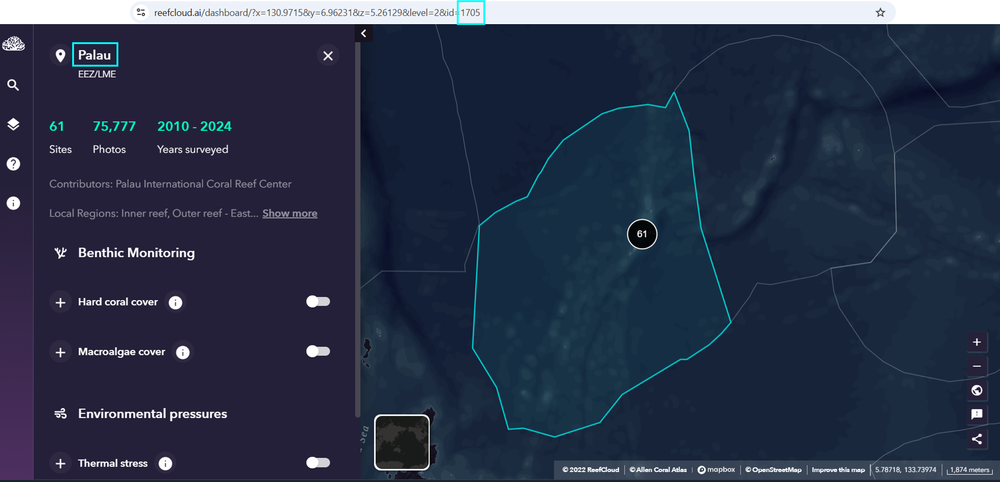
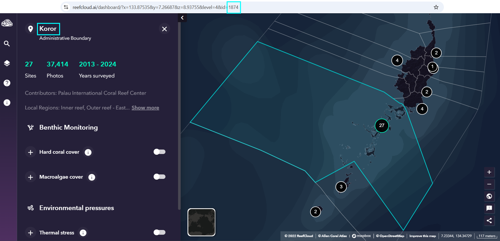

## From the Public Dashboard to `R` 

The first step is to access the [ReefCloud Public Dashboard](https://reefcloud.ai/dashboard/) and select the area of interest from which information will be extracted. The selected area corresponds to a blue-highlighted polygon on the dashboard. Each polygon, referred to as a tier, is associated with a name and a unique ID, both of which are displayed on the dashboard (Figures 1 and 2).

The aim is to automatically retrieve the *tier ID* using the corresponding place name displayed on the dashboard. The function below returns the associated ID, which is then used by the other functions in the package. Users can select a single tier or multiple tiers, provided that the place names are entered exactly as they appear on the dashboard. The retrieved *tier IDs* are stored in an object, eliminating the need to enter them manually.

The following figures illustrate this process for Palau and its Koror subregion. In this example, the *tier ID* associated with Palau is **1705** and Koror is **1874**. 

<figure style="text-align: center">
  
  <figcaption>Figure 1. Palau as displayed in the ReefCloud dashboard on 28 October 2026. The blue-highlighted areas indicate the information to be linked. </figcaption>
</figure>

<figure style="text-align: center">
  
  <figcaption>Figure 2. Koror subregion of Palau as displayed in the ReefCloud dashboard on 28 October 2026. The blue-highlighted areas indicate the information to be linked. </figcaption>
</figure>


## The `extract_tierid` function
In this example, we extract the IDs of two tiers simultaneously. The `extract_tierid()` function retrieves the corresponding IDs by matching the place names displayed on the dashboard with those provided in the `place_names` object.

### Setting up

```{r setup, message = FALSE, warning = FALSE, eval=FALSE}
# Load packages
library(reefcloudreporting) # remotes::install_github("ReefCloud/reefcloudreporting", force = TRUE)
library(dplyr)
library(purrr)
```

### Example with one tier ID

```{r extract-tierid1, message = FALSE, warning = FALSE, eval=FALSE}
place_name <- "Palau" # <-- Change the name here

tierid <- extract_tierid(place_name) %>%
  setNames(place_name)
```

*Resulting in:* 

```
> tierid         
Palau 
 1705
```

### Example with two tier IDs

```{r extract-tierid2, message = FALSE, warning = FALSE, eval=FALSE}
place_names <- c("Palau", "Koror") # <-- Change the names here

tierids <- purrr::map(place_names, extract_tierid) %>%
  setNames(place_names)
```

*Resulting in:* 

```
> tierids        
$Palau
[1] 1705

$Koror
[1] 1874
```

**The `extract_tierid()` function is the essential first step in any workflow using the package. It is important to read the function description.**