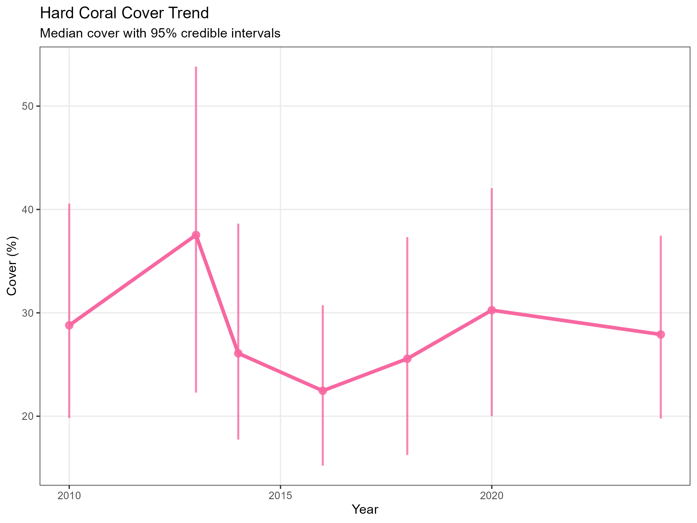
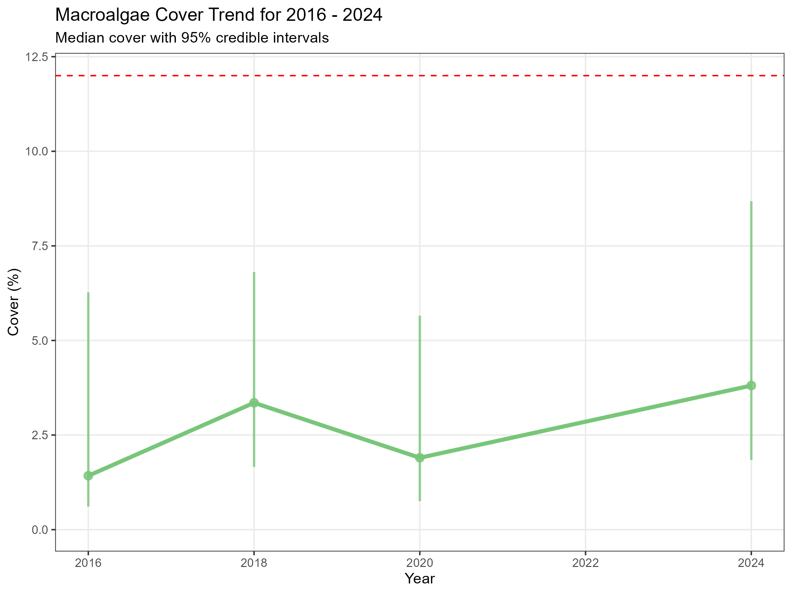
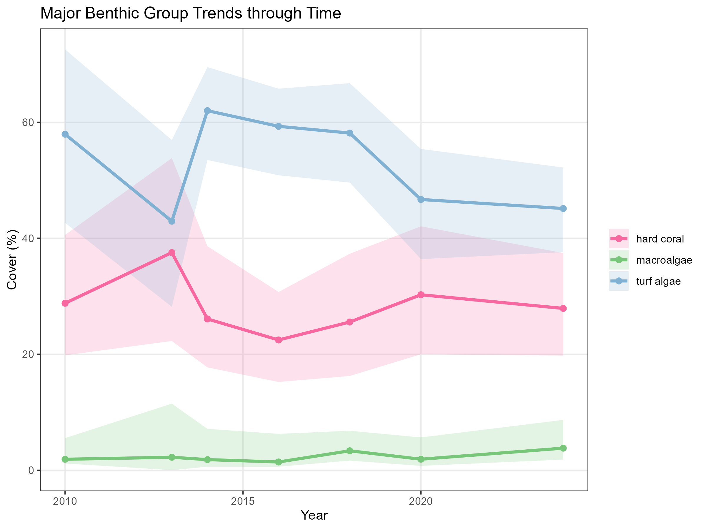
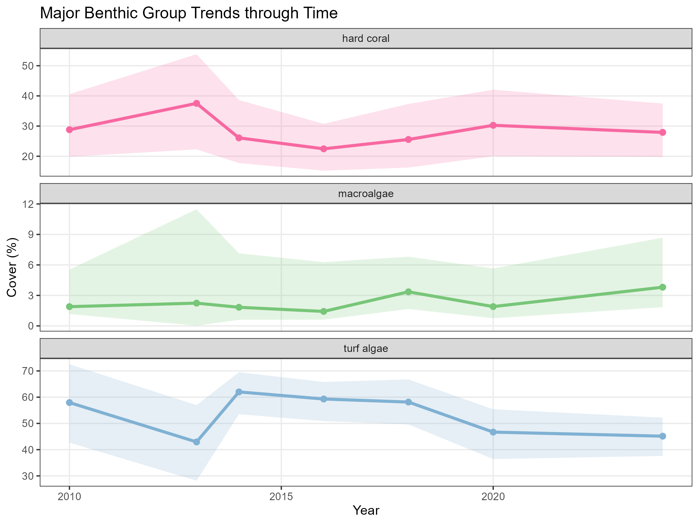

```{r, include = FALSE}
knitr::opts_chunk$set(
  collapse = TRUE,
  comment = "#>"
)
```

Trends are a useful tool in identifying patterns and changes over time, especially within the scope of a monitoring report or assessment. The ReefCloud Public Dashboard provides a series of data for the different *Tier IDs* based on the different regions, which can be used to query the ReefCloud API for data. These functions can be used as is, to plot specific plots, or extract data to customize a plot.

```{r setup, message = FALSE, warning = FALSE, eval=FALSE}
# Load packages
library(reefcloudreporting) # remotes::install_github("ReefCloud/reefcloudreporting", force = TRUE)
library(dplyr)
library(ggplot2)
```

## Accessing the data using `get_benthic_cover`

The function `get_benthic_cover` allows for data to be extracted from the Public Dashboard for a specified *Tier ID*. This data set contains a few columns of different metadata, including year, depth, type (of benthic cover), as well as the proportions of the cover at different credible intervals, including low, mean, median, and high.

```{r get-benthic-cover, message = FALSE, warning = FALSE, eval=FALSE}
all_benthic_cover <- get_benthic_cover(1705)
head(all_benthic_cover)
```


## Plotting using `plot_temporal_cover`

The easiest way to access the `Hard Coral` cover plot by year is through the `plot_temporal_trends` function. The default settings allow for the plot to be created with just the *Tier ID*.

```{r plot-trendshc, message = FALSE, warning = FALSE, eval=FALSE}
plot_trends_hc <- plot_temporal_cover(1705)
plot_trends_hc$plot

# Save plot to the figure folder, creating it if needed
dir.create("figures", showWarnings = FALSE, recursive = TRUE)
ggsave(filename = file.path("figures", "Palau_hc_trend.png")),
    plot = plot_trends_hc$plot,
    width = 8, height = 6, dpi = 300
  )
```

<figure style="text-align: center">
  
  <figcaption>Figure 1: Example trends plot showing the hard coral trend in Palau. </figcaption>
</figure>


## Defining `plot_temporal_cover` to specify benthic cover

With the `plot_temporal_cover`, aside from the *Tier ID* field, the `cover_type` field can also be specified based on the existing group codes on ReefCloud. Here, we use the *macroalgae* cover type to plot the trends for macroalgae cover. Within the function, we also use the data frame to extract the maximum value of the macroalgae cover. We then add a few specifications over the plot to constrain the years to 2016 to 2024 and add a horizontal line to show the historical maximum macroalgae cover.

```{r plot-trendsma, message = FALSE, warning = FALSE, eval=FALSE}
plot_trends_ma <- plot_temporal_cover(1705, cover_type = "macroalgae")
plot_trends_ma$plot

maxma_value <- plot_trends_ma$df.sum$high |> max() |> ceiling() # identify highest max ma cover

plot_trends_ma_edit <- plot_trends_ma$plot + 
  ggplot2::geom_hline(yintercept = maxma_value, 
                      linetype = "dashed", 
                      colour = "red") + # add a dotted line threshold for historical maximum ma value
  ggplot2::scale_x_continuous(limits = c(2016, 2024)) + # select only 2020 to 2024 data
  ggplot2::labs(title = "Macroalgae Cover Trend for 2016 - 2024") # change title

# Save plot to the figure folder, creating it if needed
dir.create("figures", showWarnings = FALSE, recursive = TRUE)
ggplot2::ggsave(filename = file.path("figures", "Palau_ma_trend.png"),
    plot = plot_trends_ma_edit,
    width = 8, height = 6, dpi = 300
  )
```

<figure style="text-align: center">
  
  <figcaption>Figure 2: Example customized trends plot showing the macroalgae trend in Palau. </figcaption>
</figure>

## Beyond `plot_temporal_cover`

For further customization of the figures, the `plot_temporal_cover` function may not be enough. While the function creates both a figure and a data frame, what can be specified with this function may not be enough for more custom plots. We can go back to the `get_benthic_cover` function to extract the full data set to produce some more specific plots, or use the `plot_temporal_cover` function multiple times to extract different plots.

```{r plot-trendsmultiple, message = FALSE, warning = FALSE, eval=FALSE}
plot_trends_hc <- plot_temporal_cover(1705, cover_type = "hard coral") # Using plot_temporal_cover to get df
plot_trends_ma <- plot_temporal_cover(1705, cover_type = "macroalgae") 
plot_trends_ta <- plot_temporal_cover(1705, cover_type = "turf algae") 

combined_df <- plot_trends_hc$df.sum |>  # Combining df
  rbind(plot_trends_ma$df.sum) |> 
  rbind(plot_trends_ta$df.sum)

combined_plot <-
  combined_df |>
  dplyr::filter(type_code %in% c("hc", "ma", "ta")) |>
  ggplot2::ggplot(
    ggplot2::aes(
      x = year,
      y = median,
      colour = type,
      fill = type
    )
  ) +
  ggplot2::geom_ribbon(
    ggplot2::aes(
      ymin = low,
      ymax = high
    ),
    alpha = 0.2,
    colour = NA
  ) +
  ggplot2::geom_line(linewidth = 1.2) +
  ggplot2::geom_point(size = 2) +
  ggplot2::scale_colour_manual(
    values = group.pal[c(
      "hard coral",
      "macroalgae",
      "turf algae"
    )]
  ) +
  ggplot2::scale_fill_manual(
    values = group.pal[c(
      "hard coral",
      "macroalgae",
      "turf algae"
    )]
  ) +
  ggplot2::labs(
    x = "Year",
    y = "Cover (%)",
    title = "Major Benthic Group Trends through Time",
    colour = NULL,
    fill = NULL
  ) +
  ggplot2::theme_bw() +
  ggplot2::theme(
    panel.grid.minor = ggplot2::element_blank()
  )

# Save plot to the figure folder, creating it if needed
dir.create("figures", showWarnings = FALSE, recursive = TRUE)
ggplot2::ggsave(filename = file.path("figures", "Palau_comb_trend.png"),
    plot = combined_plot,
    width = 8, height = 6, dpi = 300
  )
```
<figure style="text-align: center">
  
  <figcaption>Figure 3: Example combined trends plot showing the hard coral, macroalgae and turf algae trend in Palau. </figcaption>
</figure>


Instead of plotting all the trends together on one plot, it can also be useful to plot them as panels, especially if the values are very similar.


```{r plot-trendspanel, message = FALSE, warning = FALSE, eval=FALSE}
all_benthic_cover <- get_benthic_cover(1705) # Using get_benthic_cover instead

panel_plot <- all_benthic_cover |>
  dplyr::filter(type_code %in% c("hc", "ma", "ta")) |>
  ggplot2::ggplot(
    ggplot2::aes(
      x = year,
      y = median,
      colour = type,
      fill = type
    )
  ) +
  ggplot2::geom_ribbon(
    ggplot2::aes(
      ymin = low,
      ymax = high
    ),
    alpha = 0.2,
    colour = NA
  ) +
  ggplot2::geom_line(linewidth = 1.2) +
  ggplot2::geom_point(size = 2) +
  ggplot2::scale_colour_manual(
    values = group.pal[c(
      "hard coral",
      "macroalgae",
      "turf algae"
    )]
  ) +
  ggplot2::scale_fill_manual(
    values = group.pal[c(
      "hard coral",
      "macroalgae",
      "turf algae"
    )]
  ) +
  ggplot2::facet_wrap(
    ~type,
    ncol = 1,
    scales = "free_y"
  ) +
  ggplot2::labs(
    x = "Year",
    y = "Cover (%)",
    title = "Major Benthic Group Trends through Time"
  ) +
  ggplot2::theme_bw() +
  ggplot2::theme(
    legend.position = "none",
    panel.grid.minor = ggplot2::element_blank()
  )

# Save plot to the figure folder, creating it if needed
dir.create("figures", showWarnings = FALSE, recursive = TRUE)
ggplot2::ggsave(filename = file.path("figures", "Palau_panel_trend.png"),
    plot = panel_plot,
    width = 8, height = 6, dpi = 300
  )
```

<figure style="text-align: center">
  
  <figcaption>Figure 4: Example panel plot showing the hard coral, macroalgae and turf algae trend in Palau. </figcaption>
</figure>
